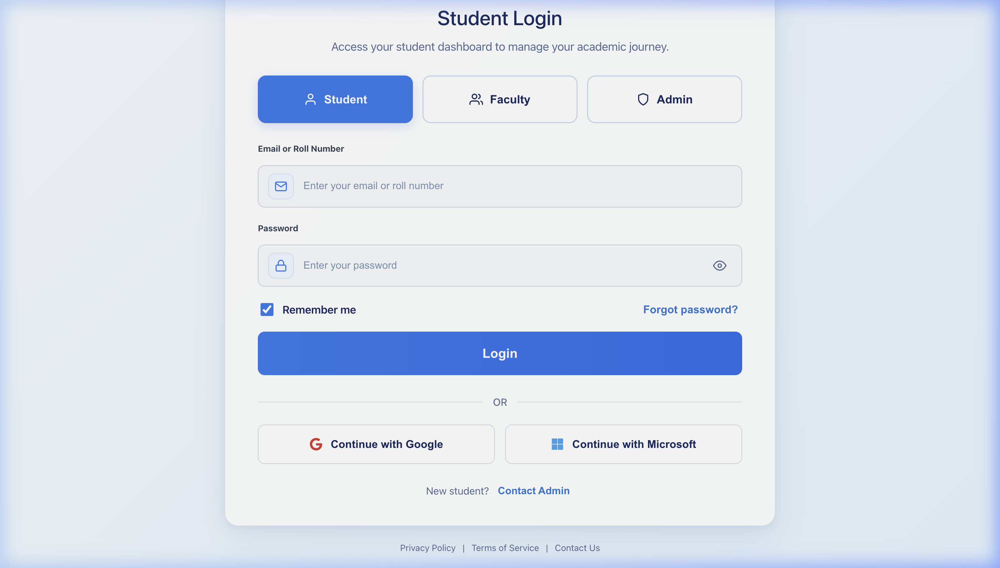
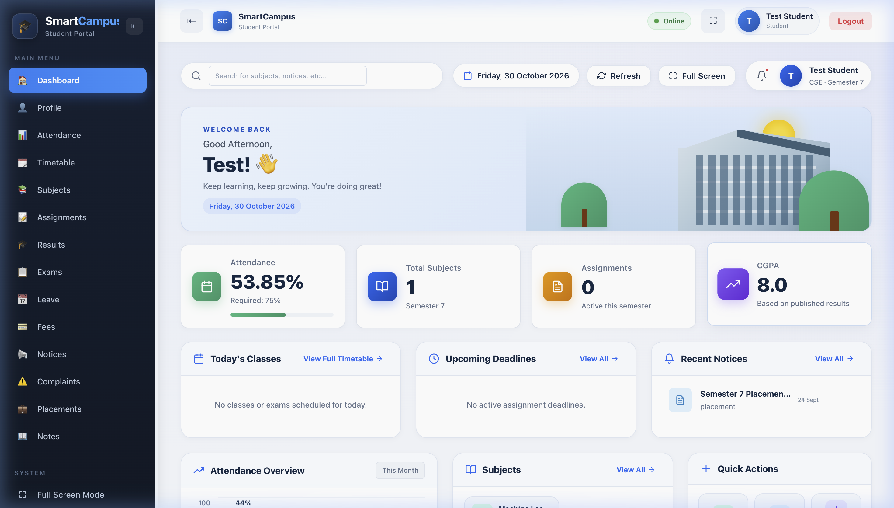
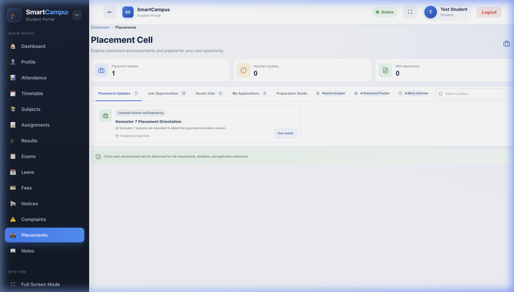
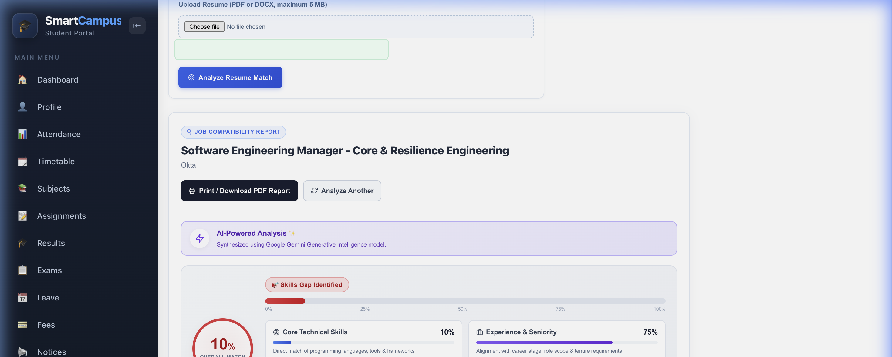
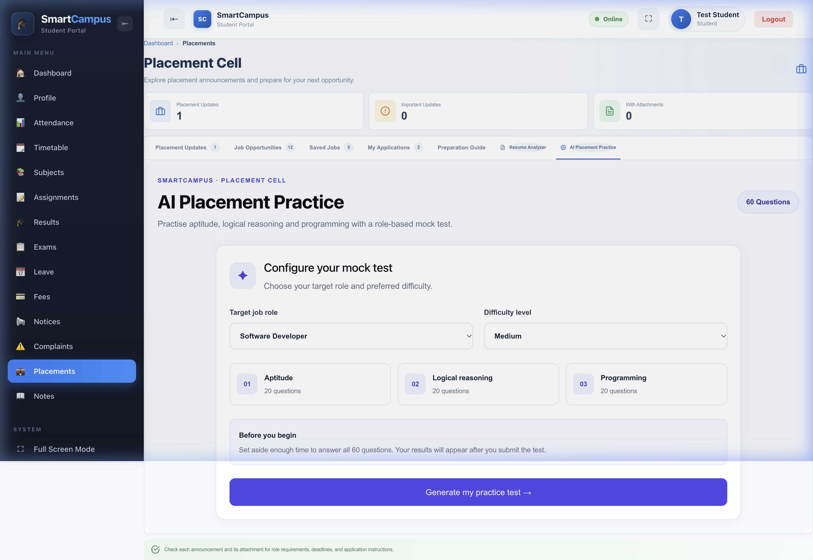
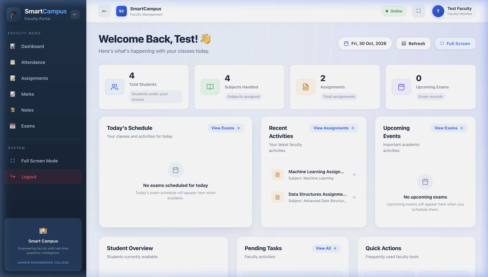
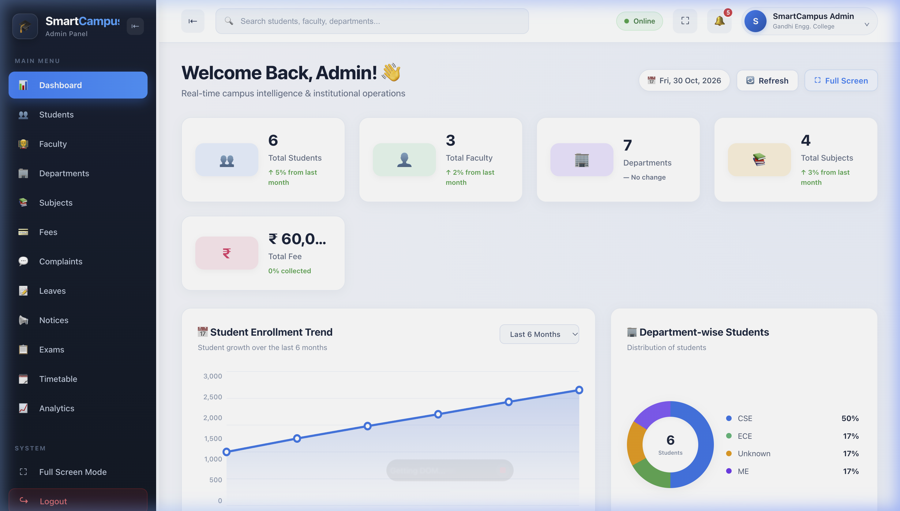
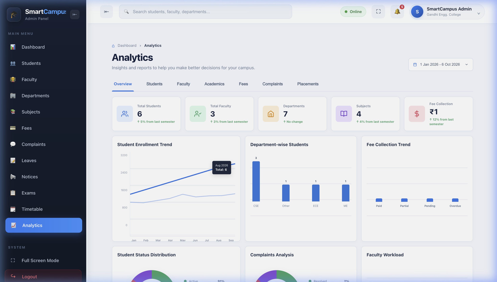
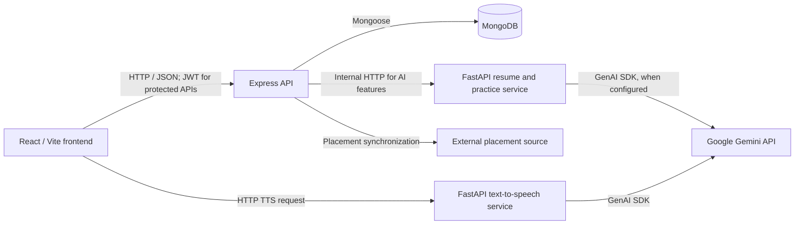

# SmartCampus

**Campus operations and career preparation in one platform.**

SmartCampus is a full-stack web application for higher-education institutions. It provides public campus information and separate student, faculty, and administrator portals, with academic management and placement-preparation tools.

> **Project status:** This README describes capabilities found in the source code and configuration. It does not imply that every feature, external integration, or production setup has been tested. See [Testing and Troubleshooting](#13-testing-and-troubleshooting) for the available checks and known caveats.

## 2. Project Overview

### Problem and purpose

Campus information and workflows such as attendance, assignments, fees, examination records, and placement preparation are often handled by disconnected tools. SmartCampus brings many of these workflows together behind role-specific portals and adds AI-assisted career-preparation services.

### Intended users

- **Students** use academic information, coursework, requests, placement listings, resume analysis, and practice tools.
- **Faculty** manage teaching-related tasks such as attendance, assignments, notes, and marks.
- **Administrators** manage campus records, notices, requests, and analytics.
- **Visitors** can browse public pages about the platform and campus.

## 3. Key Features

The following features are present in the application source. Their complete end-to-end behavior depends on a working backend, database, and (for AI features) external service configuration.

### Public website

- Home, About, Features, Placement, Contact, Blog, Help Center, and legal-information pages.
- Placement and campus information pages link users to the appropriate portal or contact options.

### Student portal

- Dashboard and profile views.
- Attendance, subjects, timetable, assignments, results, and examinations.
- Leave and complaint requests, fees, notices, notes, and placement listings.
- Resume analysis and placement-practice pages.
- Mock interview workflow with interview evaluation/history endpoints and browser camera/microphone support in the interface.

### Faculty portal

- Faculty dashboard and profile.
- Attendance management.
- Assignment creation and submission review.
- Marks, notes, and examination workflows.

### Administrator portal

- Dashboard analytics.
- Student and faculty records.
- Departments, subjects, timetables, examinations, and fees.
- Complaints, leaves, and notices.

### AI and placement services

- A Python service exposes resume-analysis and placement-practice question-generation endpoints. Resume analysis includes a rule-based fallback path.
- A separate Python service exposes Gemini-based text-to-speech.
- Node services connect resume and placement-practice flows to the Python service; placement listings also have a synchronization service.

### Partially implemented or requiring verification

- **Registration, password reset, and OAuth:** The `/register` route redirects to login. Google and Microsoft sign-in and password-reset flows are not configured.
- **Contact forms:** The current handlers display local success state and clear form values; no backend contact-submission endpoint is wired from these handlers.
- **AI availability:** Resume analysis has fallback behavior, but placement-practice generation requires a configured Gemini client in some failure cases. TTS requires a Gemini API key. Model/API availability has not been verified by this README update.
- **Realtime messaging:** Socket.IO packages and a message model exist, but a complete user-facing messaging workflow is not established by the current application navigation.
- **Frontend charting and Socket.IO client:** Dependencies are present; their use across the full interface has not been verified.

## 4. Screenshots and Application Preview

The screenshots below are actual SmartCampus UI captures in [`docs/screenshots/`](docs/screenshots/). Dashboard captures use the application's seeded/demo data. The resume-analysis capture is a cropped, redacted copy: the uploaded filename and personal analysis details are not included.

| Preview | Caption |
|---|---|
|  | Public home page |
|  | Role selection and login screen |
|  | Student portal dashboard (demo data) |
|  | Placement listings and resources |
|  | Resume analysis interface (personal upload details redacted) |
|  | Placement practice interface |
|  | Faculty portal dashboard (demo data) |
|  | Administrator portal dashboard (demo data) |
|  | Administrator analytics interface |

The unredacted local resume screenshot is excluded by `.gitignore` and is not intended for publication. Screenshots are illustrative and do not guarantee current live data or service availability.

## 5. Technology Stack

| Area | Technologies found in the project |
|---|---|
| Frontend | React 19, JavaScript/JSX, Vite 8, React Router, Axios, React Icons, Lucide React, Recharts |
| Styling | CSS |
| Backend API | Node.js, Express 5, JavaScript/CommonJS, Mongoose |
| Database | MongoDB (MongoDB Atlas or local MongoDB) |
| Authentication | JSON Web Tokens (`jsonwebtoken`), password hashing with `bcryptjs`, role middleware |
| AI services | Python, FastAPI, Pydantic, Uvicorn, Google GenAI SDK |
| File processing | Multer, `pdf-parse`, Mammoth |
| Other backend integrations | Nodemailer dependency; placement synchronization service; Socket.IO dependency |
| Development tools | npm, Vite, Oxlint, Python `venv` |

The repository does not include deployment manifests for a specific hosting provider.

## 6. Project Architecture

The React single-page application calls the Express API over HTTP. The Express application authenticates JWTs, applies role checks in route middleware, and reads or writes MongoDB through Mongoose. Some AI operations are delegated by the backend to the Python service on port `8001`. The mock-interview interface calls the separate text-to-speech service on port `8002`.



### Frontend architecture

The Vite application mounts React Router routes from [`frontend/src/App.jsx`](frontend/src/App.jsx). Authentication/session state is managed by `AuthContext`; protected role routes are guarded in the frontend and validated again by Express. [`frontend/src/services/api.js`](frontend/src/services/api.js) adds the saved JWT to API requests. The current API base URL and TTS URL are local-development addresses in source, so production deployments must configure or update them before use.

### Backend API architecture

[`backend/src/server.js`](backend/src/server.js) creates the Express application and mounts route groups for authentication, student/faculty operations, placements, exams, submissions, notices, analytics, and administration. Route middleware verifies tokens and roles. Multer and the resume route handle in-memory resume uploads; other upload flows write files under `backend/uploads/`.

### Database architecture

MongoDB is accessed through Mongoose. Models in `backend/src/models/` represent user/student/faculty profiles and campus entities including attendance, assignments, exams, fees, placements, notes, notices, submissions, resume analyses, and practice/interview attempts. [`backend/src/config/db.js`](backend/src/config/db.js) reads `MONGO_URI`, tries the local `smartcampus` database if the configured URI cannot connect, then seeds essential development data after connection. No standalone SQL migration system or checked-in database dump was found.

### Python AI Resume Analyzer

The protected Express endpoint `POST /api/resume-analyzer/analyze` accepts one PDF or DOCX file (maximum 5 MB) and a placement job ID. Express extracts document text with `pdf-parse` or Mammoth and sends the text plus job details to the Python service (`POST /analyze`). The Python service validates the result schema and returns match scores, skills, recommendations, a learning roadmap, and interview questions. If Python/Gemini is unavailable, the Node service has a rule-based fallback; the Python service also uses a heuristic fallback when no Gemini client is configured or its model attempts fail.

### Google Gemini integration

The Python resume/practice service uses `GEMINI_API_KEY` and optional `GEMINI_MODEL`; it tries the configured model and fallback model names. Placement-practice question generation returns a service-unavailable error if Gemini is not configured. The separate TTS service reads `GEMINI_TTS_API_KEY` or falls back to `GEMINI_API_KEY`. When Gemini-backed analysis is enabled, resume text and job information are sent to Google's service; avoid uploading private resumes unless users have been informed and the applicable data-handling requirements are met. Gemini-backed behavior was not verified against a live API as part of this preparation.

### Authentication and authorization

- `POST /api/auth/login` issues a JWT after credential verification.
- Protected API routes use JWT authentication middleware; many route groups also require a specific role.
- `GET /api/auth/me` returns the current user for a valid bearer token and is used by the frontend to validate a saved session.
- The frontend stores the JWT in browser `localStorage` and attaches it to API requests.
- Frontend route guards improve navigation behavior but are not a substitute for backend authorization. Keep backend authorization enabled for all protected operations.

### Main code areas

- [`frontend/src/App.jsx`](frontend/src/App.jsx) declares public routes and role-protected portals.
- [`frontend/src/context/AuthContext.jsx`](frontend/src/context/AuthContext.jsx) manages login and session restoration.
- [`frontend/src/services/api.js`](frontend/src/services/api.js) configures the Axios client and JWT header.
- [`backend/src/server.js`](backend/src/server.js) initializes Express and mounts API route groups.
- [`backend/src/config/db.js`](backend/src/config/db.js) connects Mongoose to MongoDB and runs initial data seeding.
- [`backend/src/models/`](backend/src/models/) contains Mongoose models.
- [`backend/src/routes/`](backend/src/routes/) and [`backend/src/controllers/`](backend/src/controllers/) define API behavior.
- [`backend/ai-service/`](backend/ai-service/) contains the Python AI and TTS services.

## 7. Project Directory Structure

```text
SmartCampus/
├── README.md
├── .gitignore
├── VERSION
├── docs/
│   └── screenshots/
├── frontend/
│   ├── .env.example
│   ├── .gitignore
│   ├── .oxlintrc.json
│   ├── index.html
│   ├── package.json
│   ├── package-lock.json
│   ├── README.md
│   ├── vite.config.js
│   ├── public/
│   ├── src/
│   │   ├── assets/
│   │   ├── components/
│   │   ├── context/
│   │   ├── hooks/
│   │   ├── pages/
│   │   │   ├── admin/
│   │   │   ├── faculty/
│   │   │   ├── public/
│   │   │   └── student/
│   │   └── services/
├── backend/
│   ├── .env.example
│   ├── .gitignore
│   ├── package.json
│   ├── package-lock.json
│   ├── resetAdmin.js
│   ├── scripts/
│   │   └── syncPlacements.js
│   ├── ai-service/
│   │   ├── .env.example
│   │   ├── .gitignore
│   │   ├── main.py
│   │   ├── schemas.py
│   │   ├── test_gemini.py
│   │   ├── tts_service.py
│   │   └── requirements.txt
│   ├── src/
│   │   ├── config/
│   │   ├── controllers/
│   │   ├── middleware/
│   │   ├── models/
│   │   ├── routes/
│   │   ├── services/
│   │   ├── utils/
│   │   └── server.js
│   ├── uploads/
│   │   ├── question-papers/      # Runtime uploads; .gitkeep only
│   │   └── submissions/          # Runtime uploads; .gitkeep only
└── scripts/
    ├── search_repo.sh
    ├── setup_search.sh
    └── validate-*.sh / validate-*.ps1
```

Other root-level files include `PROJECT_RULES.md`, `GSD-STYLE.md`, adapter instructions, and workflow configuration. They support project and agent workflows rather than the running application. Assistant/workflow metadata directories are excluded by `.gitignore`.

The local root also contains ignored assistant/workflow metadata, `model_capabilities.yaml`, and an orphaned `package-lock.json` with no matching root `package.json`; these are excluded from the intended GitHub upload by `.gitignore`.

## 8. Prerequisites

- Node.js `^20.19.0` or `>=22.12.0` and npm, as required by the installed Vite 8 release.
- Python 3.10 or newer for the AI services.
- MongoDB, either a local server or a reachable MongoDB Atlas deployment.
- A Google Gemini API key for the AI capabilities that call Gemini. TTS requires a key to start.
- Git to clone and contribute to the project.

## 9. Installation and Setup

### 9.1 Get the source

Use the clone URL provided by the repository owner:

```bash
git clone <repository-url>
cd SmartCampus
```

Replace `<repository-url>` with the actual repository URL; no published clone URL is configured in this project documentation.

### 9.2 Configure and start the backend

In a terminal:

```bash
cd backend
npm install
cp .env.example .env
```

Edit `backend/.env` with your own MongoDB connection string and a unique JWT signing secret. The backend reads configuration using `dotenv`. If `MONGO_URI` is unset or the configured database cannot be reached, the connection code attempts a local MongoDB fallback at `127.0.0.1:27017/smartcampus`; that local server must be running for the fallback to work. Initial data seeding runs after database connection.

Start the API:

```bash
npm run dev
```

The default API port is `5000`. The backend package also provides `npm start` for running `node src/server.js`.

### 9.3 Configure and start the frontend

In another terminal:

```bash
cd frontend
npm install
npm run dev
```

Vite prints the local frontend URL when it starts (normally `http://localhost:5173`). The current Axios client uses `http://localhost:5000/api` directly. Although `frontend/.env.example` documents `VITE_API_URL`, the current source does not read that variable.

### 9.4 Start the resume and placement-practice service (optional)

In a third terminal:

```bash
cd backend/ai-service
python3 -m venv .venv
source .venv/bin/activate
pip install -r requirements.txt
```

Create `backend/ai-service/.env` with a Gemini key and, optionally, a model name (see [Environment Variables](#10-environment-variables)). Then start the service:

```bash
uvicorn main:app --host 127.0.0.1 --port 8001 --reload
```

The backend defaults to this local URL for Python AI requests. The service defines `GET /health`, `POST /analyze`, and `POST /placement-practice/generate`.

### 9.5 Start the text-to-speech service (optional)

Use the same Python environment in another terminal:

```bash
cd backend/ai-service
source .venv/bin/activate
uvicorn tts_service:app --host 127.0.0.1 --port 8002 --reload
```

The TTS service reads its API key from the AI service environment configuration and exposes `GET /health` and `POST /tts`. The mock-interview frontend currently calls `http://127.0.0.1:8002/tts` directly.

> On Windows PowerShell, activate the virtual environment with `.venv\Scripts\Activate.ps1`. Use separate terminals for the concurrently running services.

## 10. Environment Variables

The checked-in `.env.example` files contain placeholders only. Copy the appropriate example and replace placeholders locally. Never put real secrets in this README or commit them to source control.

### Backend: `backend/.env`

| Variable | Purpose | Source behavior |
|---|---|---|
| `PORT` | Express API port | Defaults to `5000`. |
| `MONGO_URI` | MongoDB connection URI | If unavailable or connection fails, code attempts local MongoDB at `127.0.0.1:27017/smartcampus`. |
| `JWT_SECRET` | Signs and verifies authentication tokens | Set a unique, high-entropy secret. |
| `CLIENT_URL` | Allowed frontend origin for CORS | Defaults to `http://localhost:5173`. |
| `PYTHON_AI_SERVICE_URL` | Base URL for the resume/practice Python service | Defaults to `http://127.0.0.1:8001`. |
| `MONGODB_URI` | Optional MongoDB URI alias used by the placement synchronization script | `MONGO_URI` is used when this is unset. |

Safe placeholder example:

```dotenv
PORT=5000
MONGO_URI=mongodb://<username>:<password>@<host>:27017/<database>
JWT_SECRET=<generate-a-unique-random-secret>
CLIENT_URL=http://localhost:5173
PYTHON_AI_SERVICE_URL=http://127.0.0.1:8001
```

For local MongoDB without authentication, use a local development URI such as `mongodb://127.0.0.1:27017/smartcampus`. Do not reuse it for production.

### Python AI services: `backend/ai-service/.env`

| Variable | Purpose | Source behavior |
|---|---|---|
| `GEMINI_API_KEY` | Google GenAI credentials for resume analysis, practice generation, and TTS fallback configuration | Required for Gemini-backed behavior; TTS cannot start without a usable key. |
| `GEMINI_MODEL` | Preferred text-generation model | The source provides a default if omitted. |
| `GEMINI_TTS_API_KEY` | Optional separate API key for TTS | TTS falls back to `GEMINI_API_KEY` if this is omitted. |

Safe placeholder example:

```dotenv
GEMINI_API_KEY=<your-google-genai-api-key>
GEMINI_MODEL=<supported-model-name>
GEMINI_TTS_API_KEY=<optional-separate-api-key>
```

### Frontend: `frontend/.env`

`frontend/.env.example` lists `VITE_API_URL`, but the current frontend API client has a hard-coded base URL. Setting `VITE_API_URL` alone will therefore not change the API destination; update the client configuration before relying on it in a different environment.

```dotenv
VITE_API_URL=http://localhost:5000/api
```

## 11. How to Use the Application

1. Start MongoDB, the Express backend, and the frontend as described above.
2. Open the Vite URL and choose the desired role on the login screen.
3. Sign in with an account provisioned in the database. The backend seeds development data at startup, but this README intentionally does not publish credentials.
4. Use the role-specific navigation:
   - Students access academic pages and placement tools.
   - Faculty access attendance, assignment, marks, notes, and exam tools.
   - Administrators access campus records and administrative workflows.
5. To use AI-backed flows, also configure and start the relevant Python service and provide required Gemini credentials.

Do not use automatically seeded or demo accounts in production. Provision real accounts securely and change/remove development credentials before deployment.

## 12. API Documentation

The Express API is mounted under `/api`. Protected routes require:

```http
Authorization: Bearer <jwt>
```

The following endpoints and route groups are present in the backend source:

| Method | Path | Authentication / role | Purpose |
|---|---|---|---|
| `POST` | `/api/auth/login` | Public | Verify credentials and return a JWT and user record. |
| `GET` | `/api/auth/me` | Valid JWT | Return the authenticated user's current identity and role. |
| `GET` | `/api/health` | Public | API health response. |
| `GET` | `/api/students/dashboard` | Student | Student dashboard data. |
| `GET` | `/api/students/profile` | Student | Read the current student's profile. |
| `GET` | `/api/faculty/dashboard` | Faculty | Faculty dashboard data. |
| `GET` | `/api/attendance` | Faculty | Attendance records and management. |
| `GET` | `/api/placements` | Public | Placement listings. |
| `POST` | `/api/placement-practice/generate` | Student | Generate a placement practice test. |
| `POST` | `/api/mock-interview/evaluate` | Student | Evaluate an interview attempt. |
| `POST` | `/api/resume-analyzer/analyze` | Student JWT | Analyze a PDF/DOCX resume against a placement record. |
| `GET` | `/api/analytics/dashboard` | Admin | Administrator analytics dashboard. |
| `GET`, `POST`, `PUT`, `PATCH`, `DELETE` | `/api/admin/...` route groups | Admin | Manage campus records; supported operations differ by resource. |

The route groups include students, faculty, attendance, assignments, results, placements, notes, exams, submissions, question papers, fees, notices, complaints, leaves, timetable, departments, and analytics. See [`backend/src/server.js`](backend/src/server.js) for mounted prefixes and [`backend/src/routes/`](backend/src/routes/) for individual methods and role checks.

#### Login example

Request:

```http
POST /api/auth/login
Content-Type: application/json
```

```json
{
  "email": "<account-email>",
  "password": "<account-password>"
}
```

The source returns a successful response shaped like:

```json
{
  "success": true,
  "message": "Login successful.",
  "token": "<jwt>",
  "user": {
    "id": "<user-id>",
    "name": "<name>",
    "email": "<account-email>",
    "role": "student",
    "phone": "<phone-or-null>"
  }
}
```

#### Current-user example

```http
GET /api/auth/me
Authorization: Bearer <jwt>
```

This protected endpoint returns `{ "success": true, "user": { ... } }`. The `user` object includes `id`, `name`, `email`, `role`, and `phone`.

#### Python service endpoints

| Service | Method | Path | Purpose |
|---|---|---|---|
| Resume/practice service (`8001`) | `GET` | `/health` | Service health. |
| Resume/practice service (`8001`) | `POST` | `/analyze` | Resume analysis. |
| Resume/practice service (`8001`) | `POST` | `/placement-practice/generate` | Generate practice questions. |
| TTS service (`8002`) | `GET` | `/health` | Service health. |
| TTS service (`8002`) | `POST` | `/tts` | Generate speech audio. |

Request and response schemas are defined in [`backend/ai-service/schemas.py`](backend/ai-service/schemas.py) and the service modules. No OpenAPI URL is documented here because no runtime endpoint check was performed for this README.

## 13. Testing and Troubleshooting

### Available checks

From `frontend/`:

```bash
npm run lint
npm run build
```

From `backend/`:

```bash
npm run dev
npm start
```

These are run commands, not automated test commands. The backend package does not define a test script.

From `backend/ai-service/`, `test_gemini.py` is a live Gemini connectivity/model smoke script, not a unit-test suite:

```bash
python test_gemini.py
```

It requires valid Gemini configuration and may incur external API usage. It has not been executed as part of this documentation task.

### Common setup problems

| Symptom | Likely cause and next step |
|---|---|
| Backend exits while connecting to MongoDB | Check `MONGO_URI`, Atlas network access, and credentials. If using the fallback, ensure local MongoDB is installed and running on `127.0.0.1:27017`. |
| Browser reports a CORS error | Set backend `CLIENT_URL` to the exact frontend origin, including scheme and port. |
| Frontend cannot reach the API | Start the backend on port `5000`. The frontend API client currently targets `http://localhost:5000/api` directly. |
| AI calls fail or return a service error | Start the Python service on port `8001` and verify `PYTHON_AI_SERVICE_URL` and Gemini configuration. |
| Interview speech does not play | Start the TTS service on port `8002`, provide a Gemini key, and grant browser audio permissions. Browser speech support may also be used by the interface. |
| Camera or microphone is unavailable | Grant browser permissions and use a secure context; browsers generally allow localhost for local development. |
| Port already in use | Stop the process using the selected port or configure a different backend port. Update corresponding frontend/service URLs where they are hard-coded. |

## 14. Deployment

There are no checked-in deployment manifests, container definitions, CI deployment workflows, or provider-specific configuration files. Production deployment is therefore a manual setup rather than a preconfigured project workflow.

A production environment would need separately provisioned:

1. The frontend static build (`cd frontend && npm run build`).
2. The Express API process and its environment variables.
3. MongoDB with production credentials and network access.
4. The Python AI services if those features are enabled, plus Gemini credentials.
5. HTTPS and correctly configured CORS.

Before deploying, make the frontend API URL configurable and update the TTS URL, which currently points to local development addresses. Also configure backend-to-AI service networking, file-upload persistence, secrets, and account seeding for the hosting environment. No specific provider or deployment command is claimed to be supported by this repository.

## 15. Security Considerations

- Do not commit `.env`, `.env.local`, API keys, database credentials, JWT signing secrets, or real user credentials.
- Use the checked-in `.env.example` files as templates only; replace every placeholder locally.
- Keep JWT secrets unique and high entropy. Rotate any credentials that have been shared or accidentally published.
- Do not expose demo or auto-seeded account passwords in a public repository or use development seed accounts in production.
- Enforce authentication and role authorization on the backend, not only in frontend route guards.
- Restrict CORS to trusted origins and use HTTPS in production.
- Review upload validation, storage permissions, data retention, and access controls before accepting untrusted production uploads.
- The root ignore rules exclude environment files, dependencies, virtual environments, build output, and generated files. Review `git status` and staged changes before every publication.

## 16. Future Improvements

These are proposals, not claims about existing functionality:

- Add automated frontend, backend, and Python unit/integration tests.
- Make frontend API and TTS service URLs configurable through environment variables.
- Provide container/deployment configuration and a documented production environment.
- Replace development seeding with explicit, secure setup/administration procedures.
- Complete registration, password reset, and OAuth only if they are required.
- Connect contact forms to a protected, validated backend workflow.
- Add bounded cache management and review CORS settings for the TTS service.
- Add user-facing realtime messaging if Socket.IO messaging is a product requirement.
- Document API schemas and error responses comprehensively.

## 17. Contributing

Contributions are welcome. Before opening a pull request:

1. Discuss larger behavior or architecture changes in an issue.
2. Create a focused branch and keep changes scoped.
3. Install dependencies in the relevant project directory.
4. Run the available checks (`npm run lint` and `npm run build` in `frontend/`) and document any checks that cannot be run.
5. Never include secrets, local databases, uploaded user data, or generated dependency/build folders.
6. Describe the change, verification performed, and any configuration requirements in the pull request.

## 18. License

There is no root-level `LICENSE` file in the project. The backend package metadata names ISC, but that does not establish a clear license for the whole repository. The owner should choose and add an appropriate repository-level license before granting reuse permissions.

## 19. Author

No author or maintainer identity is specified here because none is confirmed in the project documentation.

## 20. GitHub Publication Checklist

Run these commands from the SmartCampus directory only after reviewing the screenshots and confirming that all staged files are appropriate for public release. The project currently has no Git metadata of its own; do not use or publish from a parent/home-directory repository.

### Check repository state

```bash
cd /path/to/SmartCampus
if [ ! -e .git ]; then git init; fi
pwd
git rev-parse --show-toplevel
git status --short
```

The Git top-level path must be the SmartCampus directory. Initializing here creates a project-local repository if one is absent; it does not overwrite the parent repository. Stop if the reported top-level path is not SmartCampus.

### Review and stage

Before staging, inspect every screenshot, remove/redact personal or confidential data, and verify that no real secrets or private uploads are present. Then review ignored files and intended changes:

```bash
git status --short --ignored
git diff --check
git add -A -- .
git status --short
git diff --cached --check
git diff --cached --stat
git diff --cached
```

Review the staged paths and contents carefully. The ignore rules protect common local secrets and generated files, but they do not detect every sensitive item.

### Commit

After reviewing and approving the staged changes:

```bash
git commit -m "Prepare SmartCampus for GitHub publication"
```

### Connect and push

Check whether a project remote already exists:

```bash
git remote -v
```

If there is no `origin`, add the URL of the intended GitHub repository. This command does not overwrite an existing remote:

```bash
git remote add origin https://github.com/<OWNER>/<REPOSITORY>.git
```

If an `origin` is already listed, verify it is the intended SmartCampus repository. Do not replace it or push to a non-empty remote without reviewing its history and getting approval.

After confirming the intended remote is empty or has a compatible history:

```bash
git branch -M main
git push -u origin main
```

Do not force-push to resolve a rejected push. Stop and reconcile repository history first.
